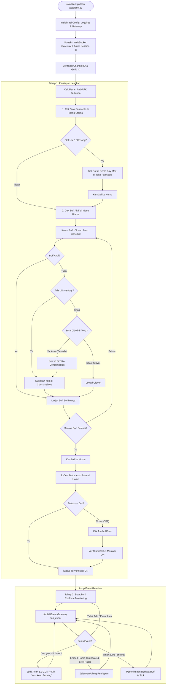

# Dokumentasi Teknis & Pengetahuan Arsitektur `autofarm.py`

Dokumen ini berisi dokumentasi lengkap mengenai arsitektur, cara kerja, mekanisme internal, dan panduan operasional dari skrip mandiri (all-in-one) [`autofarm.py`](file:///d:/Project/selfbot/autofarm.py).

---

## 1. Ringkasan & Tujuan

[`autofarm.py`](file:///d:/Project/selfbot/autofarm.py) adalah selfbot Discord mandiri (*all-in-one script*) yang dirancang khusus untuk mengotomatisasi interaksi dengan bot **Growcord Farm**. Skrip ini menggabungkan seluruh komponen jaringan (HTTP REST API dan WebSocket Gateway), navigasi menu berbasis graf (Graph Navigation), pembaca embed/komponen Discord V2, serta siklus hidup autofarm dan Anti-AFK dalam **satu berkas tunggal**.

### Fitur Utama:
1. **Pemeriksaan & Pembelian Otomatis Farmable**:
   - Membaca sisa stok farmable di menu utama (`home`).
   - Jika stok `0` atau habis, bot otomatis pergi ke `Toko` &rarr; `Farmable` &rarr; memilih item (default: `Pot o' Gems`) &rarr; klik `Buy Max` &rarr; kembali ke `home`.
2. **Manajemen Efek Buff (Lucky Clover, Arroz Con Pollo, Eggs Benedict)**:
   - Membaca daftar buff aktif di embed profil utama.
   - Jika belum aktif, membuka menu `Item` &rarr; `Consumables`.
   - Jika item tidak ada di inventori:
     - **Arroz Con Pollo** & **Eggs Benedict** otomatis dibeli di `Toko Consumables` (x5).
     - **Lucky Clover** otomatis dilewati jika tidak dimiliki (karena tidak dijual di toko).
   - Mengonsumsi item untuk mengaktifkan timer buff lalu kembali ke `home`.
3. **Pengaktifan Auto Farm**:
   - Memeriksa status `Auto Farm:` di embed `home`.
   - Jika masih `OFF`, menekan tombol `Farm` hingga berubah menjadi `ON`.
4. **Anti-AFK Realtime (Event-Driven)**:
   - Memantau aliran event WebSocket Gateway secara langsung tanpa polling lambat.
   - Mendeteksi prompt verifikasi kehadiran bot Growcord (`are you still there?`).
   - Otomatis menekan tombol `Yes, keep farming` dengan jeda waktu manusiawi (*humanized delay*).
5. **Pemeliharaan Berkala (*Self-Healing Loop*)**:
   - Secara berkala (default: 300 detik) atau saat mendeteksi pembaruan embed yang menunjukkan stok habis / Auto Farm mati, skrip langsung melakukan restock dan re-buff otomatis.

---

## 2. Alur Eksekusi (Workflow Diagram)



---

## 3. Komponen Arsitektur Internal

### A. HTTP REST Client (`Api`)
Mengelola seluruh permintaan HTTP ke endpoint Discord (`https://discord.com/api/v10`):
- **Header Khusus**: Menyerupai browser Windows Chrome asli (`User-Agent`, `Origin: https://discord.com`, `Referer: https://discord.com/`).
- **Penanganan Rate-Limit (HTTP 429)**: Membaca header/body `retry_after` dan berhenti tidur (*sleep*) sesuai durasi yang diminta Discord sebelum mencoba ulang.
- **Payload Interaksi Komponen (`POST /interactions`)**:
  - `type: 3` untuk Button Click (`component_type: 2`) dan Select Menu (`component_type: 3`).
  - `type: 5` untuk Submit Modal Form.
  - Wajib menyertakan `session_id` yang valid dari Gateway agar Discord tidak menolak interaksi akun pengguna.
  - Mengikutsertakan `nonce` berbasis snowflake Discord.

### B. Gateway WebSocket Client (`Gateway`)
Menjalankan koneksi persisten ke `wss://gateway.discord.gg/?v=10&encoding=json`:
- **Threading**:
  - Thread pembaca utama (`_loop` & `_connect`) menangani handshake, payload parsing, dan reconnect otomatis dengan backoff eksponensial jika koneksi terputus.
  - Thread detak jantung (`_heartbeat`) mengirimkan Opcode 1 secara teratur sesuai `heartbeat_interval` gateway.
- **Handshake (Opcode 2 Identify)**:
  - Mengirim token akun pengguna dengan properti desktop Windows.
  - Menangkap event `READY` untuk mendapatkan `session_id`, `user_id`, dan username.
- **Antrean Event Terfilter (`queue.Queue`)**:
  - Memfilter dan memasukkan event penting: `INTERACTION_CREATE`, `INTERACTION_MODAL_CREATE`, `MESSAGE_CREATE`, dan `MESSAGE_UPDATE` ke antrean thread-safe agar dapat dibaca oleh engine secara instan.

### C. Graf Navigasi Layar (`Screen` & `route_steps`)
Growcord bot tidak memiliki perintah teks biasa melainkan berbasis GUI tombol navigasi. Skrip memodelkan antarmuka ini sebagai **Directed Graph (Graf Berarah)**:

| ID Layar (`Screen.id`) | Indikator Regex | Tombol Terdaftar | Rute Terhubung |
|---|---|---|---|
| `home` | `\bGrowcord[^\S\r\n]+Farm\b` | Farm, Toko, Item, Profil, Event, Ganti, Market, Guild, Worlds | `toko`, `item` |
| `toko` | `Pilih\s*kategori\s*shop` | Lock, Farmable, Consumable, Gacha, Alat, Item, dll. | `locks`, `shop_farmable`, `shop_consumable`, `home` |
| `shop_farmable` | `Farmables?\s*(?:Toko\|Shop)` | Select Item, Buy Max, Kembali | `toko` |
| `shop_consumable` | `Consumables\s*Toko` | Beli Arroz, Beli Benedict, Kembali | `toko` |
| `items` | `##\s*🎒\s*Item\s*•` / `Item\s*•\s*(?:Terbatas\|Custom\|Unique\|Normal)` | Habis Pakai / Siap Pakai / Consumables, Tools, SSUs, Kembali | `consumables`, `home` |
| `consumables` | `Item\s*•\s*(?:Consumables?\|Habis\s*Pakai\|Siap\s*Pakai)` | Select Item, Use / Gunakan, Trade, ← Item, Kembali | `home`, `items` |
| `locks` | `Locks\s*Toko` | Beli WL, Beli DL, Beli BGL, Kembali | `toko` |

Pencarian rute tombol tercepat dilakukan menggunakan algoritma **Breadth-First Search (BFS)** pada fungsi `route_steps(current_id, target_id)`. Jika bot tersesat atau berada di layar tidak dikenal, tombol `Kembali` / `Back` akan otomatis ditekan untuk kembali ke layar acuan.

### D. Parser Embed & Komponen Discord V2
Growcord menggunakan format pesan modern Discord:
- Teks deskripsi dan informasi sering ditaruh dalam struktur komponen **Components V2** (Type 10 Text Display) atau embed bersarang.
- Fungsi `message_text()` mengumpulkan teks dari konten pesan, judul embed, deskripsi, footer, dan seluruh leaf text pada pohon komponen secara rekursif.
- `message_buttons()` meratakan seluruh tombol (`type: 2`) dan menu select (`type: 3`) terlepas dari apakah mereka dibungkus oleh ActionRow (`type: 1`) atau Container (`type: 17`).

---

## 4. Rincian Logika Bisnis

### 1. Pembacaan & Pembelian Farmable
- Regex pendeteksi stok:
  - `Inventori\s*:\s*([\d.,]+)\s*/` (membaca format `Inventori: 17.447 / 20.000`)
  - `Farmable\s*Saat\s*Ini\s*:.*?\((\d[\d.,]*)\s*Blocks?\)` (membaca format `Farmable Saat Ini: Diamond Ore (17.447 Block)`)
  - `Inventori\s*:\s*0\b` atau kata `Kosong`/`Tidak ada` mendeteksi kondisi kosong.
- Alur `buy_farmable(item_name)`:
  1. Navigasi: `home` &rarr; `toko` &rarr; `shop_farmable`.
  2. Select item: mencocokkan regex nama item (contoh `pot o' gems`) pada dropdown select menu.
  3. Klik tombol: mencari tombol bertuliskan `Buy Max` / `Beli Max`.
  4. Form modal: jika interaksi memicu modal Discord, skrip mengisi form dengan nilai `max` lalu melakukan submit.
  5. Kembali ke `home` untuk melanjutkan autofarm.

### 2. Logika Efek Buff
- Membaca embed `home` pada bagian `Buff Aktif:` atau `Aktif Buff:`.
- Durasi waktu (misal `10m 49s` atau `1h 15m`) dihitung dan dikonversi ke satuan detik.
- Logika pemilihan:
  - Jika sisa waktu buff > 30 detik: lewati (tidak boros item).
  - Jika buff habis atau tidak ada:
    - Buka menu `Item` &rarr; `Consumables`.
    - Cari item di dropdown inventory. Jika tidak ada:
      - Untuk **Lucky Clover**: log info dilewati (tidak bisa dibeli).
      - Untuk **Arroz Con Pollo** & **Eggs Benedict**: pergi ke `shop_consumable`, klik tombol beli, isi form modal dengan jumlah 5, tunggu konfirmasi.
    - Setelah item tersedia di inventori, pilih item di select menu, tekan tombol `Use`, dan tangani modal jumlah penggunaan (isi `1`).

### 3. Logika Anti-AFK
- Bot Growcord sewaktu-waktu mengirimkan pesan verifikasi dengan format:
  `@Username, are you still there?` disertai tombol `Yes, keep farming`.
- Deteksi dilakukan pada `is_anti_afk_prompt(msg)`:
  - Memeriksa nama bot pengirim adalah Growcord.
  - Memeriksa string `are you still there?` atau adanya tombol dengan label `yes, keep farming`.
- Penanganan pada `handle_anti_afk(msg)`:
  - Menambahkan jeda acak manusiawi `random.uniform(1.2, 2.2)` detik agar klik tidak terdeteksi sebagai aksi robotik instan (0ms).
  - Mengirim payload klik tombol dengan `custom_id` tombol tersebut.
  - Mencatat keberhasilan ke log.

---

## 5. Konfigurasi (`config.py` / Environment Variables)

Skrip dapat membaca pengaturan langsung dari [config.py](file:///d:/Project/selfbot/config.py) atau dari variabel lingkungan (*environment variables*):

| Parameter | Environment Variable | Nilai Default | Penjelasan |
|---|---|---|---|
| `TOKEN` | `DISCORD_TOKEN` | *(User Token)* | Token otentikasi akun Discord pengguna |
| `CHANNEL_ID` | `GROWCORD_CHANNEL` | `"ISI_CHANNEL_ID_DI_SINI"` | ID channel/thread tempat farm berjalan |
| `GROWCORD_APP_ID` | - | `""` | ID aplikasi Growcord (opsional; otomatis dideteksi dari pesan bot) |
| `FARMABLE_ITEM` | - | `"pot o' gems"` | Nama farmable yang dibeli saat stok habis |
| `AUTOFARM_CHECK_INTERVAL` | - | `300` | Interval pemeriksaan berkala dalam detik (5 menit) |
| `DELAY_NAV` | - | `(2.0, 3.5)` | Rentang jeda acak antar klik navigasi menu (detik) |
| `DELAY_BUY` | - | `(2.5, 4.0)` | Rentang jeda acak antar siklus beli (detik) |
| `MODAL_TIMEOUT` | - | `8.0` | Batas waktu tunggu form modal Discord muncul (detik) |
| `REPLY_TIMEOUT` | - | `15.0` | Batas waktu tunggu pesan balasan bot (detik) |
| `LOG_FILE` | - | `"runs.log"` | Berkas log penyimpanan catatan eksekusi |

---

## 6. Panduan Menjalankan

### Persyaratan:
- Python 3.9+
- Library: `requests`, `websocket-client`
```bash
pip install -r requirements.txt
```

### Menjalankan Skrip:
```bash
python autofarm.py
```

### Menghentikan Skrip:
Tekan `Ctrl + C` pada jendela terminal. Skrip akan menangkap sinyal `KeyboardInterrupt`, mematikan koneksi Gateway dengan aman, dan menutup thread latar belakang.

---

## 7. Temuan Penting & Gotchas (Reverse Engineering Insights)

1. **Kompatibilitas Console Windows (CP1252 vs UTF-8)**:
   - Terminal Windows standar secara default memakai CP1252 yang dapat mengalami crash `UnicodeEncodeError` saat menampilkan emoji (`💎`, `🎒`, `⚠️`).
   - `setup_logging()` memanggil `sys.stdout.reconfigure(encoding="utf-8", errors="replace")` di baris awal untuk mencegah crash tersebut.
2. **Modal Form Discord (`INTERACTION_MODAL_CREATE`)**:
   - Modal Discord dikirimkan melalui opcode gateway event terpisah (`INTERACTION_MODAL_CREATE`), bukan pesan obrolan biasa.
   - Saat mengirim respon modal (`type: 5`), field `data.id` harus menyertakan modal ID asli yang dikirim Discord, dan `custom_id` harus cocok dengan modal yang diminta.
3. **Penyaringan Event Non-Interaksi pada Gateway**:
   - Fungsi `capture_modal()` menampung sementara event non-modal ke list temporer dan memasukkannya kembali ke antrean di blok `finally` agar event pesan bot lain tidak hilang/tertelan.
4. **Pola Regex Horizontal Whitespace pada Layar Home**:
   - Pola regex menu utama menggunakan `\bGrowcord[^\S\r\n]+Farm\b` untuk mencegah ketidaksengajaan mencocokkan teks seperti `Growcord\nFarmables Toko`.
5. **Kebijakan Pembelian Item Buff**:
   - **Lucky Clover** tidak dapat dibeli dengan Gems di Toko Consumables Growcord. Skrip memeriksa ketersediaan Lucky Clover di inventory satu kali saja saat inisialisasi awal. Jika tidak dimiliki, skrip melewatinya agar tidak membuang waktu membuka menu inventory berulang kali.
6. **Bypass Navigasi Menu Saat Buff & Stok Siap**:
   - Jika embed utama `home` menunjukkan `Buff Aktif` (Arroz Con Pollo & Eggs Benedict) masih berjalan dan `Farmable Saat Ini` > 0, skrip tidak membuka menu Toko maupun Item. Skrip langsung menekan tombol `Farm` (jika `Auto Farm: OFF`).
7. **Kuras Antrean Gateway (*Drain Queue*) & Mode Standby Tenang**:
   - Setelah persiapan selesai, antrean event Gateway dikuras (`drain queue`) untuk mencegah event lama berstatus `OFF` memicu loop persiapan tanpa henti (*infinite trigger*).
   - Saat berada di mode standby:
     - **Re-buff**: hanya dilakukan saat buff Arroz atau Benedict benar-benar habis dari daftar `Buff Aktif`.
     - **Restock**: hanya dilakukan saat stok farmable terbaca habis (`<= 0`).
     - **Anti-AFK**: langsung merespons prompt `are you still there?` dengan menekan tombol `Yes, keep farming` (jeda 1.2 - 2.2 detik).
8. **Label Tombol Navigasi Kembali dari Layar Consumables (`← Item`)**:
   - Di Discord Growcord pada embed `Item • Habis Pakai`, tombol kembali berlabel **`← Item`** (bukan `Kembali`).
   - Pola regex tombol kembali harus spesifik `r"←\s*(?:Items?|Kembali|Back)\b|^\s*(?:Items?|Kembali|Back)\s*$"` agar tidak salah mengklik tombol lain seperti `Select Item` atau `Custom Item`.
   - Rute kembali ke menu utama `home` menempuh 2 langkah hierarkis:
     1. `consumables` &rarr; `items` via tombol `← Item`.
     2. `items` &rarr; `home` via tombol `Kembali`.
9. **Sinkronisasi Dinamis `session_id` Gateway & REST API**:
   - Gateway Discord sewaktu-waktu dapat terputus dan melakukan sambung ulang (*reconnect*), menghasilkan `session_id` baru pada event `READY`.
   - Objek `Api` menggunakan properti dinamis `session_id` via `_session_provider` (terhubung langsung ke `Gateway.session_id`) dan callback `on_session` agar seluruh payload interaksi tombol/select/modal selalu memakai session ID terkini. Hal ini mencegah kegagalan pengiriman form modal setelah reconnect.
10. **Penanganan Opcode 9 (Invalid Session) & Timeout READY Non-Fatal**:
    - Opcode 9 bukanlah error fatal token ditolak (4004), melainkan indikasi Discord bahwa sesi lama tidak dapat di-*resume* dan butuh *fresh identify*.
    - Skrip menangani Opcode 9 dan timeout READY sebagai exception reconnectable (`RuntimeError`), bukan fatal `_AuthInvalid`, sehingga skrip otomatis melakukan reconnect tanpa berhenti.
11. **Ketahanan Pengecekan Dropdown Consumables & Modal Form**:
    - Fungsi `use_inventory_item` memverifikasi keberadaan opsi item di menu select dropdown sebelum mengirim klik interaksi. Jika item tidak ada, skrip mencatat peringatan dan mengembalikan `False` tanpa memicu fatal `NavError`.
    - Jika form modal pembelian di Toko Consumables tidak muncul atau ditolak, aktivasi item ditunda ke siklus berikutnya tanpa memaksakan konsumsi item fiktif.
12. **Supervisor Loop 24/7 (*Self-Healing Supervisor*)**:
    - Fungsi `main()` dibungkus dalam loop pengawas 24/7 dengan backoff eksponensial.
    - Setiap kendala jaringan, koneksi socket, atau navigasi yang lolos tidak mematikan bot, melainkan memicu pemulihan otomatis, refresh status panel ke `home`, dan melanjutkan autofarm.
    - Hanya sinyal `Ctrl+C` (`KeyboardInterrupt`) atau token tidak valid (`AuthError`) yang menghentikan eksekusi bot.
13. **Rotasi Berkas Log (*RotatingFileHandler*)**:
    - Menggunakan `RotatingFileHandler` (maksimal 10 MB per berkas, cadangan 3 berkas) untuk mencegah pembengkakan ukuran `runs.log` saat berjalan terus-menerus selama berhari-hari/berminggu-minggu.
14. **Discord Gateway RESUME (Opcode 6) & Opcode 7 (Reconnect)**:
    - Gateway Discord kini mendukung mekanisme RESUME resmi Discord. Saat terjadi socket blip atau pemeliharaan server (Opcode 7), client tidak lagi melakukan *fresh identify* (Opcode 2) yang memboroskan kuota harian 1000 identify, melainkan mengirim Opcode 6 (`session_id` + sequence `seq`). Discord akan membalas dengan Opcode 0 `RESUMED` dan memutar ulang (*replay*) event yang terlewat tanpa jeda.
15. **Zero Gems Guard (*Fatal Exit saat Kehabisan Gems*)**:
    - Saat mencoba membeli farmable (Pot o' Gems) atau buff (Arroz/Benedict), jika respons bot mengindikasikan Gems tidak cukup (`"tidak cukup"`, `"insufficient"`, `"kehabisan"`, `"gems"`), skrip melemparkan `GemsExhaustedError`.
    - Supervisor loop menangkap error ini dan langsung menghentikan proses bot dengan peringatan visual mencolok, mencegah spamming toko tanpa henti yang dapat memicu deteksi bot/banned.
16. **Safe Drain Queue (*Preservasi Anti-AFK Saat Navigasi Menu*)**:
    - Fungsi `safe_drain_events()` memeriksa setiap event yang terkuras setelah navigasi. Jika ada pesan verifikasi Anti-AFK (`are you still there?`) yang masuk saat bot sedang berada di dalam menu Toko/Item, event tersebut langsung ditangani dan tombol `Yes, keep farming` diklik sebelum event lama lainnya dibuang.
17. **Kontinuitas Pemakaian Lucky Clover**:
    - Jika pengguna memiliki beberapa Lucky Clover di inventory, bot akan terus menggunakannya setiap kali buff 30 menit kedaluwarsa.
    - Bot hanya menandai Clover sebagai dilewati jika dan hanya jika stok di inventory sudah benar-benar 0 (habis).
18. **Pemantauan Realtime Judul Konsol/CMD**:
    - Menggunakan API Windows `SetConsoleTitleW` dan ANSI escape code `\033]0;...\007` untuk menampilkan status terkini bot langsung pada judul jendela terminal/CMD (contoh: `Growcord Bot [ON] | Stock: 17.447 | Buffs: 3/3 | AFK Handled: 4`).
